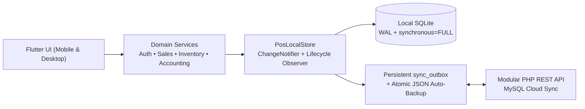

<div align="center">


# Aza POS

**Offline-First Point of Sale & Business Management Platform**

*Built for retail shops, supermarkets, pharmacies, and growing merchants — fast checkout, real-time inventory, credit ledgers, accounting, and 60+ reports in English & Kiswahili.*

<p>
  
  
  
  
  
  
  
</p>

<p>
  <a href="#core-features">Features</a> •
  <a href="#architecture">Architecture</a> •
  <a href="#data-durability--reliability">Durability</a> •
  <a href="#design-system">Design System</a> •
  <a href="#project-structure">Structure</a> •
  <a href="#getting-started">Getting Started</a> •
  <a href="#android-release-builds">Release Builds</a>
</p>

</div>

---

## Core Features

| Module | Capabilities |
| :--- | :--- |
| **Sales & Checkout** | Fast counter POS supporting whole & fractional/measured units (`kg`, `L`, `m`, `pcs`), barcode scanning, split payments, line discounts, held/suspended sales, and Bluetooth ESC/POS thermal or PDF/WhatsApp receipts. |
| **Inventory & Products** | Stock tracking, bulk packs, expiry dates, product imagery, CSV bulk import/export, cost & margin tracking, and low-stock indicators. |
| **Customers & Credit Ledger** | Customer directory, credit sales, debt aging, printable statements, and partial/full debt repayments. |
| **Suppliers & Receiving** | Supplier directory, purchase receiving drafts, multi-line stock intake, and automatic stock cost updates. |
| **Cash Register & Expenses** | Shift open/close reconciliation, cash-in/cash-out movements, variance tracking, and categorized business expenses. |
| **Accounting Engine** | Double-entry chart of accounts, journal entries, fixed assets registry, and bank statement reconciliation. |
| **Reports & Analytics** | 60+ detailed, summary, graphical, accounting, and multi-store reports with PDF/CSV export and daily SMS summaries. |
| **Multi-Store & Staff** | Role-based staff permissions, multi-branch switching, and full **English (`en`)** + **Kiswahili (`sw`)** localization. |

---

## Architecture

Aza POS follows an **offline-first hybrid architecture**. All writes commit locally to SQLite first for zero-latency POS operation, while background sync pushes queued mutations to the optional PHP/MySQL backend.



### Tech Stack

| Layer | Technology |
| :--- | :--- |
| **Client Framework** | Flutter `>=3.35.0 <3.36.0` · Dart `>=3.3.0 <4.0.0` |
| **State Management** | `provider` with selective domain-scoped services |
| **Local Persistence** | `sqflite` (SQLite WAL mode) · `AndroidKeyStore` AES-GCM token vault |
| **Hardware & Media** | Google ML Kit Code Scanner · Bluetooth SPP ESC/POS Thermal Printing · `pdf` & `printing` |
| **Cloud Backend** | Modular PHP (`backend/src/Api.php` router + focused domain services) · MySQL |
| **Localization** | Custom `.arb` catalog pipeline (`lib/l10n/arb/app_en.arb`, `app_sw.arb`) |

---

## Data Durability & Reliability

Designed so merchants **never lose sales or inventory records**, even during power cuts, app kills, or unstable mobile networks:

- **ACID SQLite Configuration**: Opens with `PRAGMA journal_mode = WAL`, `PRAGMA synchronous = FULL`, and `PRAGMA foreign_keys = ON`.
- **Outbox-Protected Sync**: Pending local mutations are stored in a persistent `sync_outbox`. Cloud pulls are guarded while unresolved outbox items exist, and empty server responses never wipe local tables.
- **Lifecycle Auto-Flush & Atomic Backups**: `WidgetsBindingObserver` automatically flushes pending writes on app pause/background and maintains an atomic local JSON snapshot (`azapos_autobackup_latest.json`).
- **Crash-Safe Startup**: Non-critical plugins (local notifications & Android 13+ permission prompts) initialize after the first rendered frame with defensive error handling, and database boot errors surface a clean recovery screen rather than crashing.

---

## Design System

All screens adhere to the **Aza POS low-glare design system** defined in [`lib/ui/widgets/app_design.dart`](lib/ui/widgets/app_design.dart) and [`lib/ui/widgets/app_theme.dart`](lib/ui/widgets/app_theme.dart).

| Role | Token | Hex | Usage |
| :--- | :--- | :--- | :--- |
| **Brand Primary** | `AppColors.primary` | `#22B8C4` | Primary pill CTAs, active tabs, focus accents |
| **Brand Deep** | `AppColors.primaryDeep` | `#1396A1` | Pressed states, emphasis highlights |
| **Selling Price / Positive** | `AppColors.successDeep` | `#047857` | Selling prices, revenue gains, paid states |
| **Page Background** | `AppColors.pageBackground` | `#D6E6F0` | Low-glare canvas across all screens |
| **Card / Section Surface** | `AppColors.surface` | `#E0EEF5` | Cards, dialogs, form panels (no harsh `#FFFFFF`) |
| **Header & Navigation** | `AppColors.headerSurface` | `#CBE6F0` | App bars, bottom navigation, desktop rail |
| **Border & Divider** | `AppColors.border` | `#B0CBDB` | Crisp structural separation |
| **Text Hierarchy** | `ink` / `textMain` / `textMuted` | `#111827` / `#1F2937` / `#6B7280` | High-contrast readable typography |

**Component Geometry & Typography**:
- **Inputs & Search**: Sharp corners (`BorderRadius.zero`) for crisp POS data entry
- **Buttons & Toasts**: Pill radius (`AppRadius.pill`) · minimum `42–44px` touch targets
- **Containers**: `10px` cards (`AppRadius.standard`), `12px` dialogs, `18px` bottom sheets
- **Typeface**: `Manrope` across mobile, tablet, and desktop layouts

---

## Project Structure

```text
GreenLeaf/
├── android/                  # Android config (com.azapos.app, prod/dev flavors, Kotlin channels)
│   └── app/src/main/kotlin/  # Native bridges: Bluetooth thermal printer, ML Kit scanner, Keystore
├── assets/                   # App logo, fonts (Manrope), and navigation icons
├── backend/                  # Modular PHP/MySQL REST API + backend test suite
│   ├── src/                  # Api.php router, AuthService, OrderService, ResourceRepository, etc.
│   └── tests/                # PHP integration tests (php backend/tests/api_test.php)
├── lib/
│   ├── database/             # SQLite schemas, migrations, WAL config, accounting/sales/supplier DBs
│   ├── l10n/                 # English & Kiswahili .arb sources + generated Dart catalogs
│   ├── service/              # PosLocalStore, hybrid cloud sync, outbox, notifications, domain services
│   ├── ui/                   # Feature screens (auth, home/POS, products, payment, reports, accounting, more)
│   └── utils/                # Currency, date, and measurement quantity formatters
├── test/                     # Flutter unit & widget tests (POS, accounting, reports, measurement sales)
└── tool/                     # Localization code generator (generate_l10n.dart)
```

---

## Getting Started

### Prerequisites

- **Flutter SDK**: `>=3.35.0 <3.36.0`
- **Dart SDK**: `>=3.3.0 <4.0.0`
- **Android Toolchain**: Android SDK & JDK 17
- **Backend (optional)**: PHP 8.x & MySQL for cloud sync

### Local Development

```bash
# 1. Install dependencies
flutter pub get

# 2. Run on a connected device or emulator (dev flavor)
flutter run --flavor dev

# 3. Static analysis & test suite
flutter analyze
flutter test
```

### Localization & Backend Verification

```bash
# Regenerate English & Kiswahili localization catalogs after editing lib/l10n/arb/*.arb
dart run tool/generate_l10n.dart

# Run PHP backend integration tests
php backend/tests/api_test.php
```

---

## Android Release Builds

Before publishing to Google Play, configure your release keystore in `android/key.properties` *(kept out of version control)*.

```bash
# Universal APK (bundles armeabi-v7a, arm64-v8a & x86_64 for direct installs on any Android device)
flutter build apk --release --flavor prod

# Google Play App Bundle (.aab)
flutter build appbundle --release --flavor prod
```

> **Distribution Tip**: Avoid sharing a single `--split-per-abi` APK with end users, as each split only installs on one CPU architecture. Use the **universal APK** for direct sideloading and the **`.aab` bundle** for Google Play.

---

## License

Distributed under the **MIT License**.
